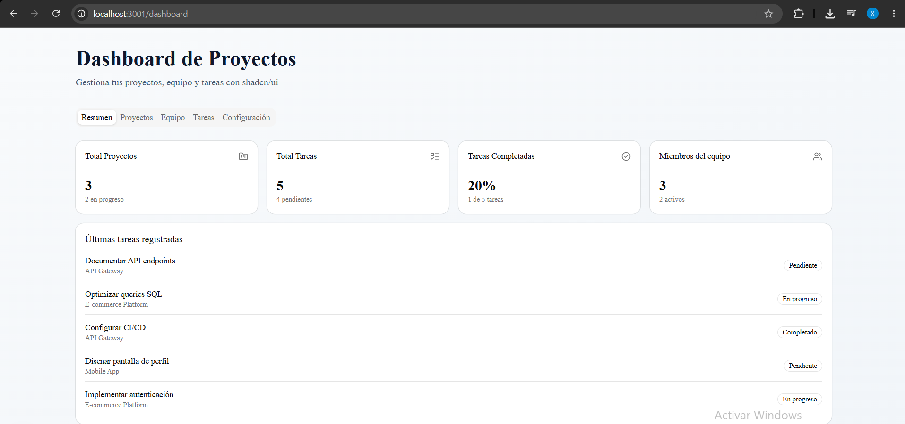
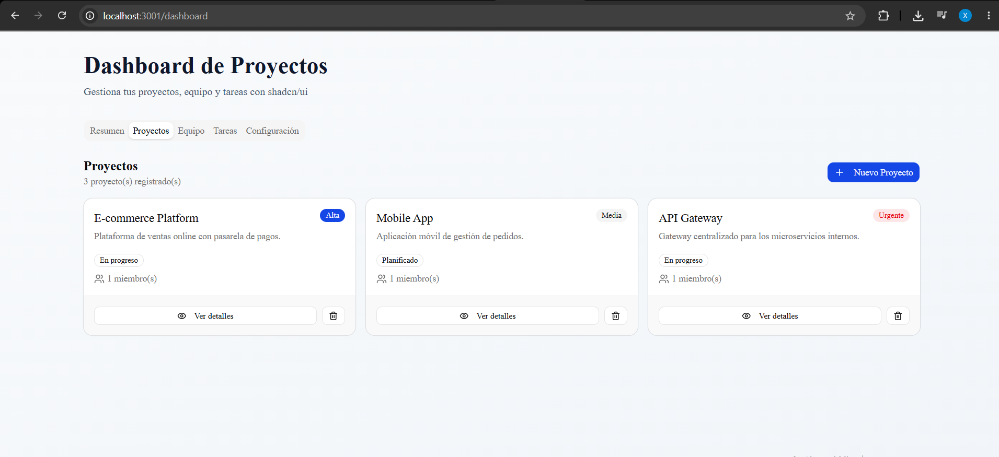
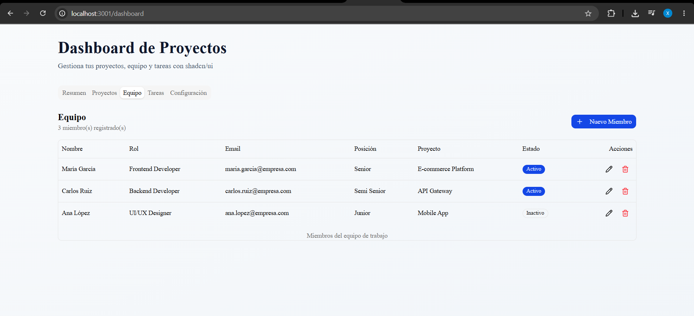
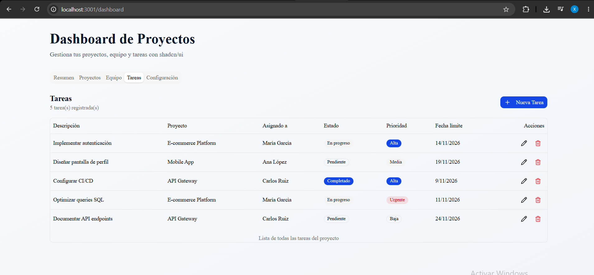
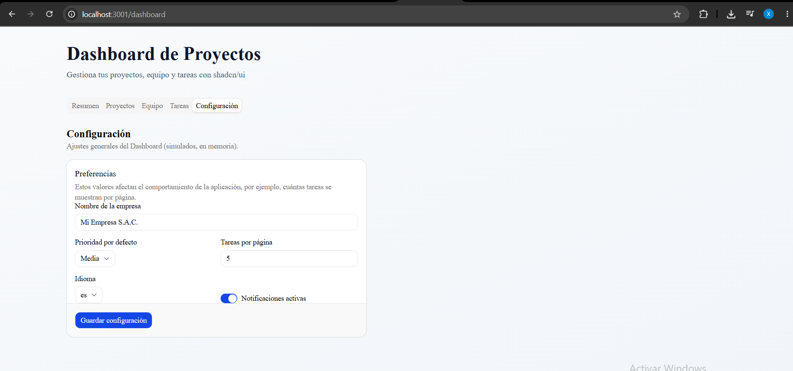

<div align="center">

# 🧪 Lab 11 — Desarrollo de Aplicaciones Web Avanzado

### Componentes y Estilización con Next.js, CSS Modules, Tailwind CSS y shadcn/ui


**Autor:** Edwin William Arévalo Sermeño
**Curso:** Desarrollo de Aplicaciones Web Avanzado · 5 - C24 - Sección A-B

</div>

---

## 📂 Estructura del repositorio

Este repositorio agrupa los **dos proyectos** desarrollados durante el laboratorio 11:

```
Lab11-DAWA/
├── next-components-styling/   # Ejercicio 1: Componentes con CSS Modules + Tailwind
└── next-shadcn-ui/            # Ejercicio 2 + Tarea: Dashboard con shadcn/ui
```

| Proyecto | Descripción | Ruta de prueba |
|---|---|---|
| 🎨 `next-components-styling` | Sistema de componentes reutilizables (Button, Card, Badge, Input) combinando **CSS Modules** y **Tailwind CSS** | `/styling` |
| 📊 `next-shadcn-ui` | Dashboard de proyectos con **shadcn/ui**: CRUD de Proyectos, Equipo y Tareas, Spinner, Alert, Calendar y Pagination | `/dashboard` |

---

## 🎯 Objetivos del laboratorio

- Diseñar interfaces modernas y funcionales empleando herramientas de estilización avanzadas.
- Comparar y combinar **CSS Modules** con **Tailwind CSS**.
- Instalar, personalizar y combinar componentes de **shadcn/ui**.
- Implementar lógica de negocio (CRUD) sobre datos en memoria.

---

## 🚀 Cómo ejecutar cada proyecto

### 1️⃣ Componentes con CSS Modules + Tailwind

```bash
cd next-components-styling
npm install
npm run dev
```

➡️ Abrir **http://localhost:3000/styling**

### 2️⃣ Dashboard con shadcn/ui

```bash
cd next-shadcn-ui
npm install
npm run dev
```

➡️ Abrir **http://localhost:3000/dashboard**

---

## 🧩 Componentes shadcn/ui utilizados

| Componente | Uso en el proyecto |
|---|---|
| `Button`, `Card`, `Tabs`, `Badge`, `Avatar` | Base del Dashboard |
| `Dialog`, `Form`, `Select`, `Input`, `Label`, `Textarea` | Formularios de Proyectos, Equipo y Tareas |
| `Table`, `Checkbox` | Listado de tareas y equipo |
| `Spinner` | Simulación de peticiones al "backend" |
| `Alert` | Validaciones de formularios |
| `Calendar` + `Popover` | Selección de fechas (nacimiento, límite, etc.) |
| `Pagination` | Paginado del listado de tareas |
| `Switch` | Estados on/off (activo, notificaciones) |

---

## 📸 Capturas







---

## 🔗 Enlaces

- **Aplicación desplegada en Vercel:** `<agrega aquí el link de Vercel>`

---

## 📝 Conclusiones

1. La implementación de nuevos componentes de shadcn/ui permitió mejorar la presentación y funcionalidad del Dashboard. Componentes como Spinner, Alert, Calendar y Pagination facilitaron la simulación de peticiones, las validaciones y la organización de la información.
2. El desarrollo de los módulos Proyectos, Equipo y Tareas permitió implementar operaciones CRUD y relacionar sus respectivos datos. Esto hizo que el Dashboard pasara de mostrar información principalmente estática a gestionar registros mediante una lógica de negocio más completa.
3. Finalmente, la actualización del Resumen y la implementación de Configuración complementaron las funcionalidades del sistema. Con ello, se consiguió un Dashboard más interactivo, organizado y funcional, aplicando los conceptos de gestión de datos y desarrollo de interfaces trabajados durante el laboratorio.

---

<div align="center">

Hecho por Diego Nina Malqui usando **Next.js**, **Tailwind CSS** y **shadcn/ui**

</div>